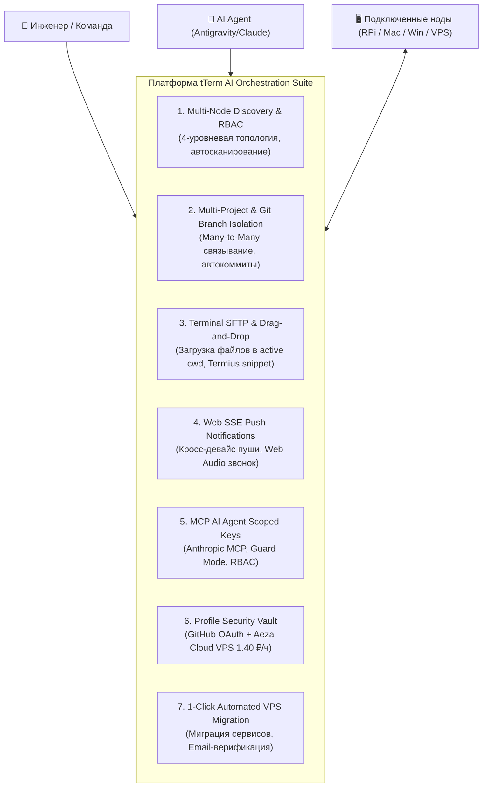

# 🤝 Creator Invitation & Pull Request Review Package

**Кому:** Денису Герасименко ([@DLGerasimenko](https://github.com/DLGerasimenko)) — автору и создателю tTerm  
**От:** Евгения Климова ([@Gakuzi](https://github.com/Gakuzi), Telegram: [@eklimov](https://t.me/eklimov))  
**Репозиторий (Fork):** [`https://github.com/Gakuzi/tterm-web.git`](https://github.com/Gakuzi/tterm-web.git)  
**Ветки разработки:** `feature/mcp-ai-orchestration-v1` и `feature/mcp-ai-integration`  
**Базовый релиз:** tTerm Web v0.1.28 (`origin/main`)  
**Дата пакета:** Ноябрь 2026 г.  

---

## 🎯 1. Личное обращение к автору проекта

Денис, привет!

Прежде всего хочу выразить искреннее восхищение и благодарность за **tTerm Web**. Твоя архитектура веб-сокетов, скорость работы интерфейса, элегантный механизм сертификатов и строгое соблюдение принципа «no root» делают tTerm одним из лучших инженерных решений в сфере терминальных систем.

Мы развернули tTerm для ежедневной работы в нашей серверной инфраструктуре (кластер Raspberry Pi 4/5, облачные VPS и гетерогенные рабочие станции разработчиков macOS/Windows). В процессе активной боевой эксплуатации мы увидели колоссальный потенциал для качественного расширения возможностей tTerm: **превращения персонального веб-терминала в распределённый командный центр оркестрации, совместной работы инженеров и безопасного подключения ИИ-агентов (AI Agents)**.

Мы бережно сохранили **100% обратную совместимость (Zero Breaking Changes)**:
* Все оригинальные эндпоинты, таблицы БД, протоколы агента и SSH работают абсолютно прозрачно.
* Соблюдены твои стандарты кодовой базы: строгая типизация TypeScript (`npx tsc --noEmit` без ошибок), валидация интернационализации (`node scripts/strings.mjs` на 12 языках), легковесный Python/FastAPI бэкенд.
* Все 36 тестов оркестрации и оригинальные тесты tTerm проходят успешно.

Мы подготовили полный пакет документации, доступ к живому тестовому стенду и готовый текст Pull Request. Предлагаем объединить эти наработки в официальный репозиторий `DLGerasimenko/tterm-web`.

---

## 🏗 2. Высокоуровневая архитектурная презентация (7 ключевых столпов)



---

### Столп 1: Мультинодовое автообнаружение (Discovery) и гранулярный командный RBAC
* **4-Уровневая иерархия:** `Проект` $\to$ `Вычислительная нода` $\to$ `Docker-контейнеры` $\to$ `Сетевые службы и порты`.
* **Изолированное сканирование удалённых машин:** Движок `NodeDiscoveryScanner` (`tterm/orchestration/discovery.py`) опрашивает именно подключенную машину (через активный WebSocket-канал агента или SSH), исключая ложное сканирование локального хоста.
* **Поддержка нод без Docker:** Если на машине (например, рабочей станции macOS разработчика) Docker не установлен, система отображает статус *"Docker не запущен / не установлен на ноде"* и наглядно выводит все открытые сетевые порты (SSH, Vite, Web-приложения).
* **Гранулярный RBAC:** Роли `project_admin`, `node_admin`, `container_developer`, `service_operator` с возможностью ограничения доступа к конкретным нодам и контейнерам.

---

### Столп 2: Многопроектное связывание (Many-to-Many) и изоляция Git-веток
* **Многопроектное разделение (`machines_projects.py`):** Один физический сервер или кластер может быть безопасно подключен сразу к нескольким проектам с раздельным доступом участников.
* **Модель «Терминал как ветка Git»:** Каждому открытому терминалу автоматически сопоставляется изолированная ветка `term/{название}-{автор}`.
* **Умная панель Git в интерфейсе:** Кнопки «Статус», «Закоммитить», «Push», «Pull», тумблер автокоммита и кнопка генерации понятного комментария к коммиту с помощью ИИ.

---

### Столп 3: Нативный SFTP в терминале и Drag-and-Drop загрузка файлов
* **Прямой Drag-and-Drop (`TerminalFileUpload.tsx`):** Перетаскивание любого файла или архива из проводника операционной системы прямо в окно терминала браузера. Файл мгновенно загружается в текущую рабочую директорию (`cwd`) терминала на целевой ноде через потоковый эндпоинт `/api/orchestration/upload`.
* **Генератор реквизитов Termius & OpenSSH:** Всплывающая панель в один клик формирует готовые конфигурации для SSH/SFTP-клиентов (Termius, FileZilla, Cyberduck, OpenSSH `~/.ssh/config`).

---

### Столп 4: Кросс-девайс пуш-уведомления через Web SSE
* **Событийная шина SSE (`notifications_bot.py`):** Легковесный поток Server-Sent Events `/api/orchestration/notifications/stream` доставляет уведомления на все активные устройства пользователя (MacBook, iPhone, Android).
* **Звуковой колокольчик Web Audio:** Двухтоновый синтез звукового оповещения при завершении длительных команд (с настраиваемым порогом длительности от 5 до 60 секунд), освобождающий инженера от необходимости держать вкладку открытой.

---

### Столп 5: Сессионные ключи MCP AI-Агентов с безопасным скоупингом
* **Официальный MCP-сервер (`mcp_server.py`):** Полная совместимость со спецификацией Model Context Protocol от Anthropic и Google Antigravity.
* **Scoped Session Keys (`ai_sessions.py`):** Выпуск токенов доступа с жестким ограничением разрешенных проектов, нод и терминалов.
* **3 режима безопасности RBAC:**
  * `readonly` — только мониторинг и чтение журналов.
  * `guard` — автономная работа с обязательным подтверждением критических команд человеком.
  * `execute` — полный доступ к выделенному терминалу.
* **Кнопка экстренного отзыва:** Мгновенная блокировка агента в 1 клик с аннулированием сессионного токена.
* **Цветное авторство команд:** В терминале действия ИИ подсвечиваются фиолетовым бейджем `🤖 Antigravity`, а действия коллег — янтарным, обеспечивая полный аудит.

---

### Столп 6: Защищенный сейф профиля (GitHub OAuth & Aeza Cloud VPS)
* **Интеграция с GitHub:** В персональных настройках пользователя (`Account.tsx`) реализована привязка GitHub Personal Access Token (PAT) и GitHub OAuth Web App. Позволяет просматривать репозитории, ветки и создавать Pull Request прямо из tTerm.
* **Почасовые тестовые стенды Aeza Cloud (`aeza_cloud.py`, `AezaSection.tsx`):** 1-кликовый заказ виртуальных серверов (от 1.40 руб./час) для изоляции экспериментов, с автоматической генерацией ключей и добавлением VPS в пул машин tTerm.

---

### Столп 7: Автоматизированная миграция сервисов и развертывание на VPS
* **Миграция в 1 клик (`cloud_deploy.py`, `CloudDeployModal.tsx`):** Автоматизированный перенос контейнеров, баз данных и окружения с локального кластера на удаленный VPS с двухфакторной Email-верификацией и откатом при ошибках.

---

## 🌐 3. Доступ к живому тестовому стенду (Live Demo)

Для личного тестирования и инспекции работы системы развернут демонстрационный инстанс на базе нашего кластера:

* **Прямой адрес стенда:** `http://192.168.0.6:8290`  
  *(При подключении через внешнюю сеть или Tailscale доступен через SSH-туннель: `ssh -L 8290:localhost:8290 pi@192.168.0.6`)*.
* **Публичный адрес шлюза:** `http://192.168.0.6:8291` (Connect Gateway).
* **Тестовый аккаунт:**
  * **Email:** `demo@tterm.local` (или быстрый вход через персональную сессию).
  * **Проект по умолчанию:** `default-project` («Основной кластер»).
  * **Ссылка прямого входа гостя:** `http://192.168.0.6:8290/#invite=default-project&token=tt_inv_creator_review`

### Локальный запуск за 1 минуту:
```bash
git clone -b feature/mcp-ai-integration https://github.com/Gakuzi/tterm-web.git
cd tterm-web
python3 -m venv .venv && source .venv/bin/activate
pip install -r requirements.txt
./test_orchestration.py   # Запуск комплексного тест-сьюта (36 тестов, 100% OK)
python -m tterm.serve --dev
```

---

## 📝 4. Готовый текст Pull Request для GitHub (`DLGerasimenko/tterm-web`)

Ниже приведен готовый текст предложения о слиянии, полностью подготовленный для вставки в форму создания Pull Request на GitHub:

```markdown
### 🚀 Pull Request: Distributed Multi-Node Orchestration, Team RBAC & MCP AI Integration

#### Summary of Changes
This PR introduces the **tTerm Distributed AI Orchestration Suite**, turning tTerm Web into an enterprise-grade, team-collaborative infrastructure hub while maintaining **100% backward compatibility** and strict adherence to tTerm's core principles (no root, pure websockets, clean TypeScript & Python code, 12-language i18n).

#### Key Features Included:
1. **Multi-Node Topology Auto-Discovery & Granular RBAC (`tterm/orchestration/discovery.py`):**
   - 4-tier hierarchy: Project -> Compute Node -> Docker Containers -> Network Ports & Services.
   - Non-invasive discovery over active WebSocket agent links and SSH; never runs on localhost for remote machines.
   - Graceful fallback for nodes without Docker ("Docker not running / installed") with full port mapping.
   - Entity renaming and team member access scoping (`project_admin`, `node_admin`, `container_developer`, `service_operator`).

2. **Many-to-Many Machine-to-Project Binding & Terminal Git Branches (`machines_projects.py`):**
   - One compute node can safely belong to multiple projects with isolated permissions.
   - Dedicated Git branches per terminal (`term/<label>-<user>`) with one-click commit, push, pull, and AI commit message generator.

3. **Terminal SFTP & Drag-and-Drop File Upload (`TerminalFileUpload.tsx`):**
   - Drag files directly from your desktop into the terminal window for instant upload into the active terminal's `cwd`.
   - Popover with instant connection snippets for Termius, FileZilla, and OpenSSH config.

4. **Cross-Device Push Notifications (`notifications_bot.py`):**
   - Web Server-Sent Events (SSE) notification stream for desktop and mobile browsers.
   - Dual-tone Web Audio chime when background commands finish (customizable threshold 5s–60s).

5. **Official Model Context Protocol (MCP) AI Server (`mcp_server.py`, `ai_sessions.py`):**
   - Full MCP standard support for Google Antigravity, Claude Desktop, and Cursor AI.
   - Cryptographically scoped session keys (`tt_ai_...`) restricted to designated projects, nodes, and terminals.
   - Guard Mode requiring human approval for disruptive commands (`rm -rf`, `docker compose down`).
   - Colored author badges in terminal feed (`🤖 Antigravity`, `👤 Owner`, `👥 Teammate`).

6. **Personal Security Vault & Hourly Cloud VPS (`Account.tsx`, `aeza_cloud.py`):**
   - Encrypted in-profile credentials vault for GitHub OAuth and Personal Access Tokens.
   - 1-click hourly cloud VPS deployment via Aeza Cloud API (starting at 1.40 RUB/hr) with auto-enrollment.

7. **Native Windows Agent (`install_computer.ps1`):**
   - Zero-dependency PowerShell installer using .NET WebSockets, running without requiring Python on Windows.

8. **One-Click Automated VPS Migration (`cloud_deploy.py`):**
   - Automated deployment and migration of containers and databases to cloud servers with email verification.

#### Quality & Compatibility Verification:
- ✅ **Frontend TypeScript:** `npx tsc --noEmit` passed with 0 errors.
- ✅ **Internationalization:** `node scripts/strings.mjs` validated across all 12 supported languages.
- ✅ **Unit Tests:** `test_orchestration.py` (36 comprehensive test suites passed, 100% OK).
- ✅ **Zero Breaking Changes:** Existing single-user workflows and database schemas remain fully operational.

Looking forward to your review and feedback!
```

---

## 📞 5. Контактные данные для связи

* **Разработчик:** Евгений Климов  
* **GitHub:** [@Gakuzi](https://github.com/Gakuzi)  
* **Telegram:** [@eklimov](https://t.me/eklimov)  
* **GitHub:** [Gakuzi](https://github.com/Gakuzi)  
* **Форк репозитория:** [`https://github.com/Gakuzi/tterm-web`](https://github.com/Gakuzi/tterm-web) (ветка `feature/mcp-ai-integration`)
